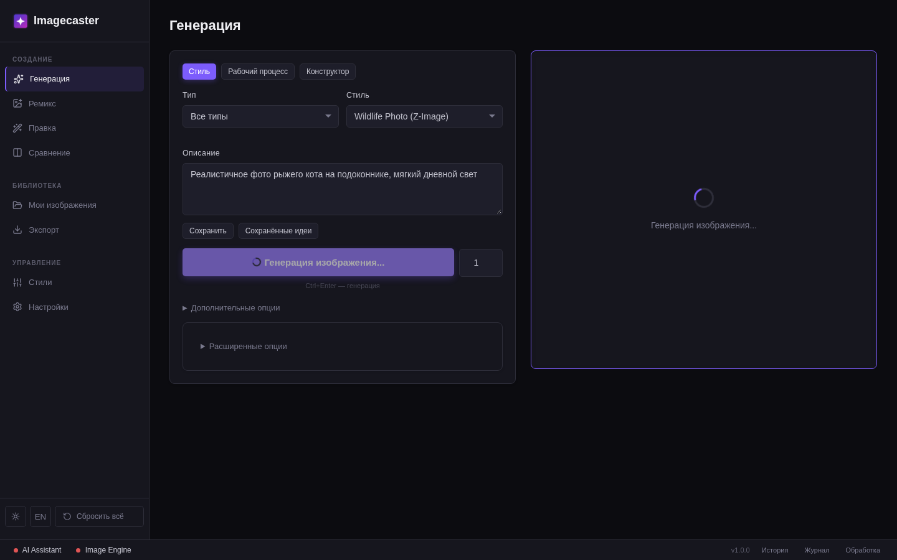
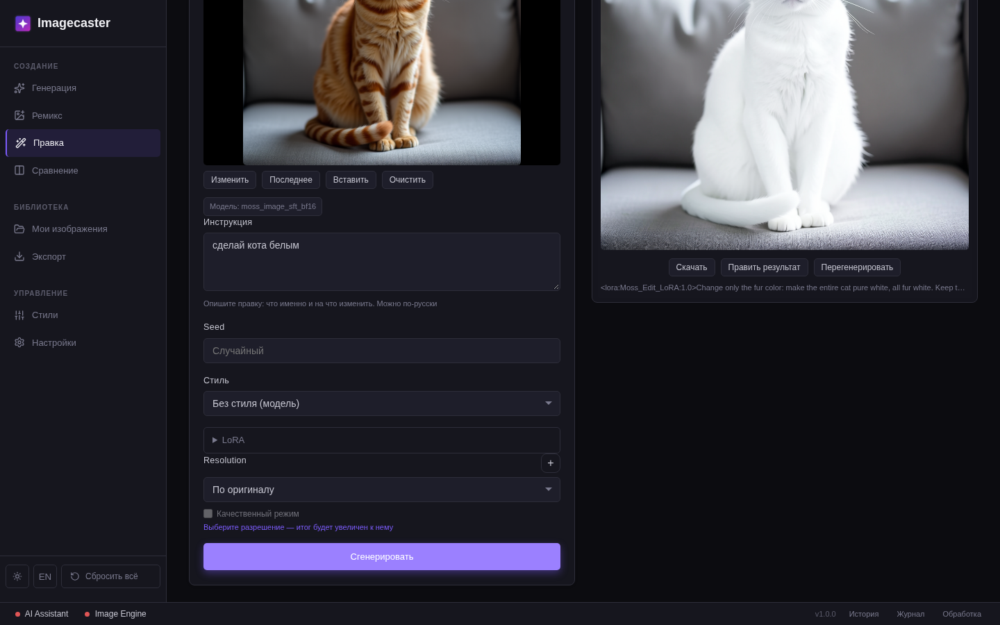
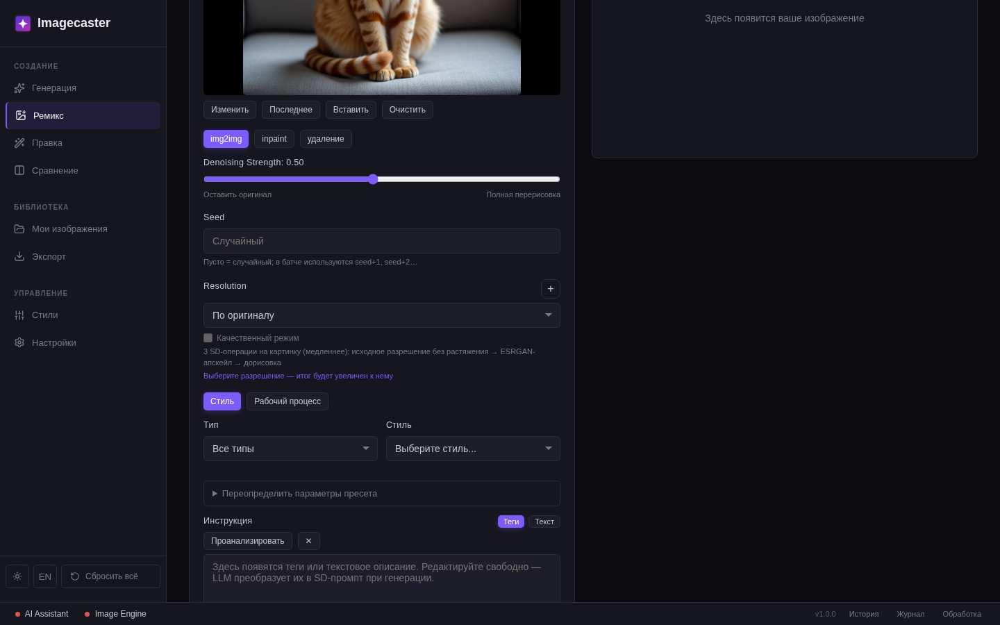
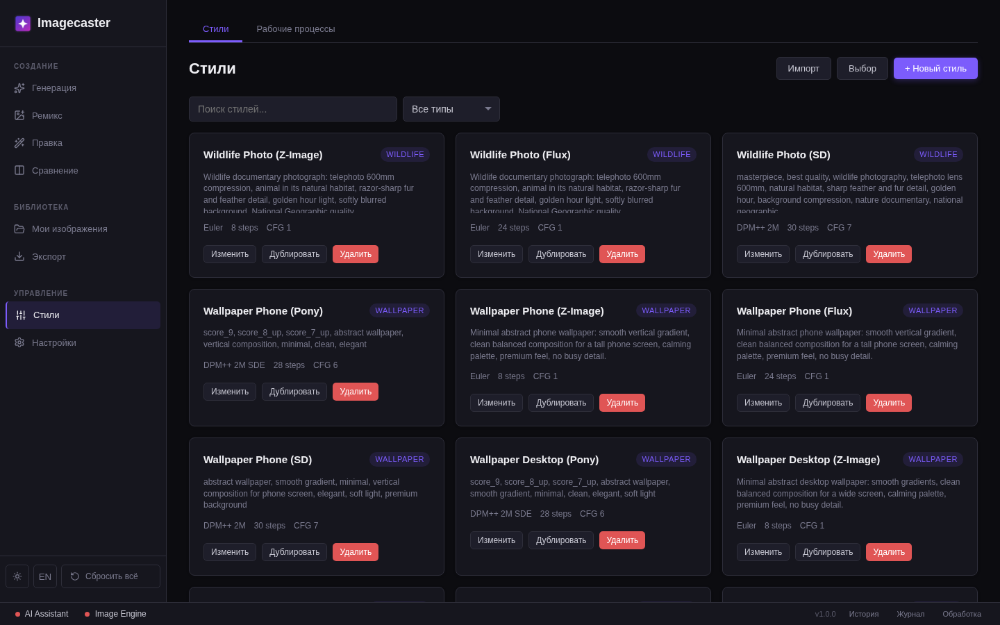
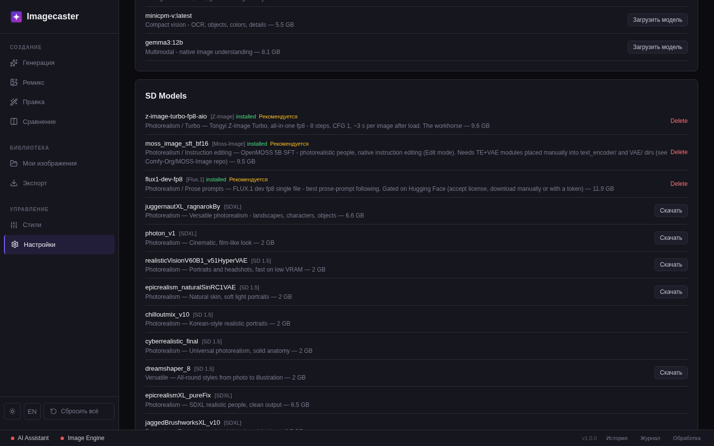
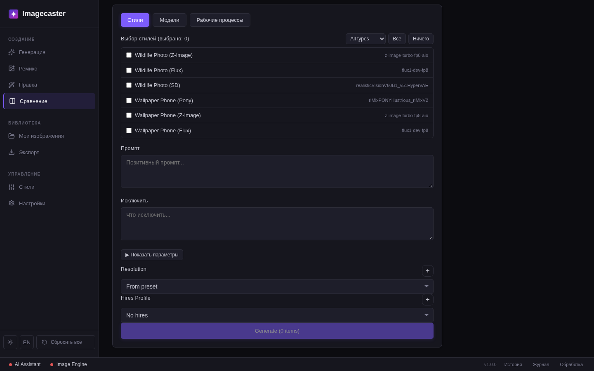
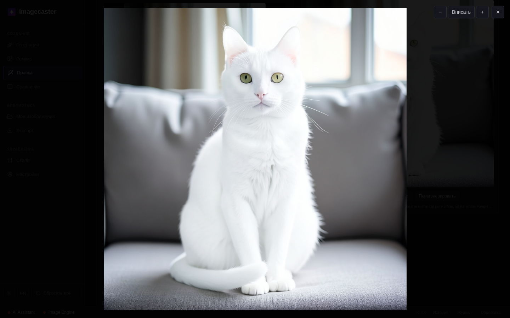
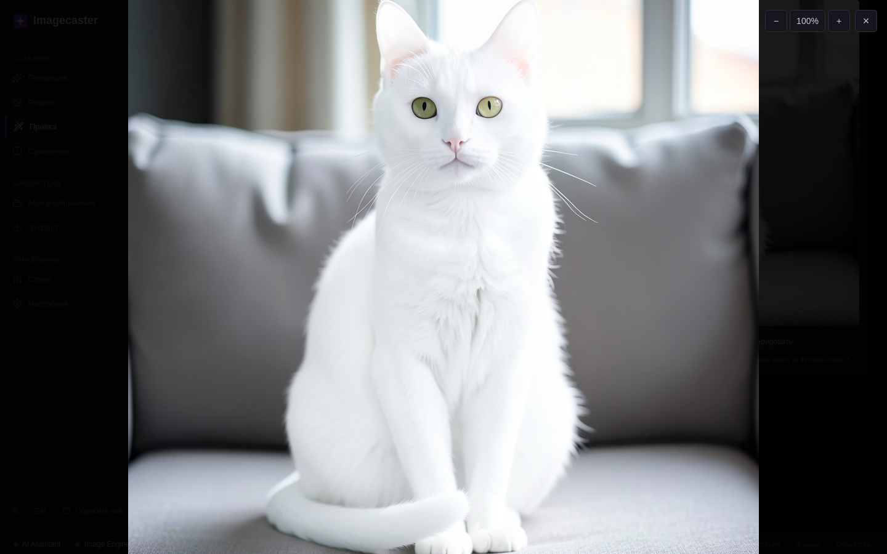

# Imagecaster

**Десктоп-приложение для генерации изображений через Stable Diffusion + LLM.**

[English](README.md) | [Changelog](CHANGELOG.md)

**Зачем и чем отличается.** Stable Diffusion умеет многое, но каждую картинку в нём настраиваешь руками: сэмплер, CFG, веса LoRA, теги. ComfyUI может всё, но это конструктор из нод, и собирать его надо самому. Imagecaster устроен проще: выбрал стиль, описал сцену по-русски и получил картинку. Промпт для SD пишет нейросеть, технические настройки уже лежат в стиле. Всё работает на твоём компьютере, поэтому вариантов можно перебирать сколько угодно и ничего за них не платить.

| | Что нужно знать | Сколько стоит вариант | Для кого |
|---|---|---|---|
| Голый SD (WebUI) | сэмплеры, CFG, LoRA, синтаксис тегов | бесплатно, на своём железе | кто готов разбираться в настройках |
| ComfyUI | всё то же, плюс как собирать схемы из нод | бесплатно, на своём железе | технари, которым нужна полная свобода |
| Облачные сервисы | ничего | подписка или оплата генераций | кому не на чем запускать модель у себя |
| **Imagecaster** | **ничего: стиль и описание обычными словами** | **бесплатно, на своём железе** | **кто хочет картинку, а не настройки** |

> **Примечание:** Imagecaster подключается к локальному Stable Diffusion WebUI ([Forge Neo](https://github.com/Haoming02/sd-webui-forge-classic/tree/neo) — см. [гайд по настройке](docs/setup-ru.md)) и к [OpenAI-совместимому LLM](https://ollama.com). Оба работают на вашем железе — без облака, подписок и утечки данных.

---

## Ключевые возможности

- **LLM-инжиниринг промптов** — опишите сцену обычным языком, LLM объединит ваш замысел со стилем-пресетом в готовый SD-промпт
- **Режим правки** — редактирование реальных фото по инструкции: «замени брюки на юбку» меняет именно это, сохраняя человека, позу и сцену
- **Умное удаление** — нарисуйте маску, LLM проанализирует контекст и дорисует фон
- **Конструктор и пайплайны** — собирайте многошаговые цепочки инлайн или сохраняйте как переиспользуемые рабочие процессы
- **Качественный вывод** — нативное разрешение → ESRGAN-апскейл → дорисовка деталей, одной галочкой
- **Каталог моделей** — скачивание рекомендованных моделей и LoRA в один клик (серверный режим)
- **Сессии** — каждое изображение помнит, чем создано; работа организована в сессии
- **Детский режим** — PIN-защита и фильтрация контента по категориям

## Скриншоты

<p align="center">
  <a href="docs/screenshots/main-generation.png" target="_blank"></a>
  <a href="docs/screenshots/edit.png" target="_blank"></a>
</p>
<p align="center">
  <a href="docs/screenshots/from-image.png" target="_blank"></a>
  <a href="docs/screenshots/presets.png" target="_blank"></a>
</p>
<p align="center">
  <a href="docs/screenshots/settings-catalog.png" target="_blank"></a>
  <a href="docs/screenshots/compare.png" target="_blank"></a>
</p>

<p align="center">
  <a href="docs/screenshots/edit-viewer.png" target="_blank"></a>
  <a href="docs/screenshots/edit-viewer-zoom.png" target="_blank"></a>
</p>

## Возможности

### Генерация

| Возможность | Описание |
|---------|-------------|
| Текст-в-картинку | Генерация по тексту: стили-пресеты, стеки LoRA, оверрайды сэмплера |
| Картинка-в-картинку (Ремикс) | Преобразование изображений с контролем denoise, батчами и качественным режимом |
| Инпейнтинг | Canvas-редактор масок, полноэкранный режим, кисти, отмена |
| Умное удаление | Удаление объектов с помощью ИИ — маска, контекст анализируется vision-LLM |
| **Режим правки** | Настоящее редактирование по инструкции на Flux 2 Klein с reference-движком: модель меняет ровно то, что вы просите, сохраняя лицо, позу и сцену. Стили-пресеты добавляют свои LoRA, не перекрашивая фото |
| Конструктор | Соберите пайплайн инлайн (пресет, denoise и LoRA на каждом шаге), прогоните или сохраните как рабочий процесс |
| Пайплайны | Многошаговые составные пресеты с пошаговыми LoRA, импорт/экспорт в JSON |
| Качественный вывод | Нативный проход → нейро-апскейл до целевого разрешения → дорисовка деталей; предупреждения о пропусках видны в UI |
| Батч-генерация | N изображений с живым прогрессом, прерыванием и восстановлением очереди |
| Профили разрешения / hires | Независимые профили в БД; hires-профили с авто-fallback на неподдерживаемых бэкендах |
| Апскейл | Апскейл x2 в один клик; нейро-апскейлер резолвится из списка бэкенда |
| Явный Seed | Опциональный сид с батч-семантикой `seed+i` |

### Интеграция с LLM

| Возможность | Описание |
|---------|-------------|
| Умный мердж | Описание обычным языком → готовый SD-промпт; проза-инструкция для моделей класса Flux/Z-Image |
| Визион-анализ | Анализ загруженных изображений (быстрый или глубокий режим) сразу в ремикс |
| Memory Guard | LLM-модели автоматически выгружаются из VRAM перед тяжёлыми генерациями — только когда это реально помогает |
| Настраиваемые инструкции | Редактируйте системные промпты, формирующие вывод LLM |

### Организация работы

| Возможность | Описание |
|---------|-------------|
| Сессии | Сессии-проекты; каждый элемент хранит мету создания (модель, LoRA, цепочка пайплайна) |
| Пресеты | Сохраняйте, организуйте по типам, импорт/экспорт с валидацией моделей |
| Сравнение | Сравнение пресетов и моделей бок-о-бок |
| Каталог моделей | Рекомендованные модели/LoRA/LLM со статусом установки и скачиванием в один клик (серверный режим) |
| Файл-браузер | Сетка миниатюр, полноэкранный просмотрщик с зумом, отправка в Ремикс/Правку/Экспорт |
| Экспорт | Ресайз, конвертация (PNG/JPEG/WebP), контроль качества, экспорт-пресеты |
| Очередь | Персистентная очередь задач с ретраями, паузой/возобновлением и восстановлением после перезапуска |
| MCP-сервер | Встроенный сервер Model Context Protocol (`imagecaster-mcp`) — управляйте студией из ИИ-агентов |
| Тема | Светлая/тёмная тема; интерфейс RU/EN |

### Безопасность

| Возможность | Описание |
|---------|-------------|
| Детский режим | PIN-защита, фильтрация контента по категориям, безопасная модификация промптов |

## Модели

| Модель | Для чего |
|--------|----------|
| SD 1.5 / SDXL | Лёгкие модели для слабых видеокарт, любые стили |
| Pony / Illustrious | Аниме, мультяшные и стилизованные персонажи |
| Flux 1 | Точное следование подробному описанию, реализм |
| Z-Image Turbo | Быстрый фотореализм |
| Moss-Image | Точное следование описанию, фотореализм людей |
| Flux 2 Klein | Эффекты постобработки, замена и удаление объектов, сохранение лица |

Подробности и полный список пресетов: [Модели и пресеты](docs/models-ru.md).

## Требования

### Внешние сервисы

Imagecaster подключается к двум сервисам в вашей сети:

- **Stable Diffusion WebUI** — нужен [Forge Neo](https://github.com/Haoming02/sd-webui-forge-classic/tree/neo) с флагом `--api` (на A1111 и оригинальном Forge — только базовая генерация). Из коробки работают современные модели (Z-Image Turbo, FLUX.1 fp8, Moss-Image — каталог умеет их скачивать). По умолчанию: `http://localhost:7860`. См. [гайд по настройке](docs/setup-ru.md).
- **LLM API** — любой OpenAI-совместимый сервер: [Ollama](https://ollama.com/), [llama.cpp](https://github.com/ggerganov/llama.cpp) или [LM Studio](https://lmstudio.ai/). По умолчанию: `http://localhost:11434/v1`

Проще всего — [Imagecaster Server](https://github.com/Zazza/imagecaster-server): сам ставит Forge Neo и Ollama на компьютер с видеокартой, запускает их и скачивает модели из каталога.

### Разработка

- [Go](https://go.dev/dl/) >= 1.25
- [Node.js](https://nodejs.org/) >= 18
- [Wails CLI](https://wails.io/) v2

| Платформа | Требования |
|----------|-------------|
| macOS | CLI-инструменты Xcode (`xcode-select --install`), 10.15+ |
| Linux | `libgtk-3-dev`, `libwebkit2gtk-4.1-dev` |
| Windows | [WebView2](https://developer.microsoft.com/en-us/microsoft-edge/webview2/) (встроен в Win 10/11) |

## Скачать

Готовые сборки — на странице [Releases](https://github.com/Zazza/imagecaster/releases).

## Быстрый старт

```bash
# Установка Wails CLI
go install github.com/wailsapp/wails/v2/cmd/wails@latest

# Клонирование и запуск
git clone https://github.com/Zazza/imagecaster.git
cd sd-ai
make setup   # первый запуск: скачать зависимости
make dev     # запуск с hot-reload
```

Hot-reload фронта: `http://localhost:34115`.

### Сборка

```bash
make build   # продакшн-бинарник → build/bin/imagecaster
```

## Сервер

Серверный компонент выделен в отдельный репозиторий: [imagecaster-server](https://github.com/Zazza/imagecaster-server). В серверном режиме приложение управляет бэкендом (старт/стоп/рестарт, статистика GPU) и скачивает модели прямо из каталога.

## Технологии

| Слой | Стек |
|-------|-------|
| Бэкенд | Go 1.25 |
| Десктоп | [Wails](https://wails.io/) v2 |
| Фронтенд | Vue 3 + Vite |
| База данных | SQLite (чистый Go, без CGo) |
| LLM | OpenAI-совместимый API |
| Генерация | Stable Diffusion WebUI API (Forge Neo) |

## Как это работает

```
Пользователь пишет описание обычным языком
         │
         ▼
  LLM-мердж
  (описание + стиль-пресет + инструкция → SD-промпт)
         │
         ▼
  Генерация через Stable Diffusion WebUI
         │
         ▼
  Превью → Качественный апскейл → Экспорт
```

**Ремикс (From Image):** загрузка → опциональный вижн-анализ → img2img / инпейнтинг / умное удаление, батчи и качественный режим

**Правка:** загрузите фото → напишите инструкцию на любом языке («замени брюки на юбку») → reference-движок меняет ровно это; продолжайте править результат

## Структура проекта

```
├── main.go              # Точка входа
├── app.go               # Wails RPC-биндинги
├── internal/
│   ├── config/          # Конфигурация
│   ├── llm/             # LLM-клиент
│   ├── preset/          # SQLite CRUD
│   ├── sd/              # Клиент Stable Diffusion
│   ├── generation/      # Сервис генерации (вкл. правку, quality, memory guard)
│   ├── queue/           # Очередь задач с ретраями и паузой
│   ├── session/         # Управление сессиями
│   ├── importexport/    # Импорт/экспорт пресетов
│   ├── settings/        # Сервис настроек
│   ├── promptutil/      # Утилиты промптов
│   ├── filebrowser/     # Бэкенд файлового браузера
│   ├── serverclient/    # Клиент серверного API + встроенный каталог моделей
│   ├── kids/            # Фильтрация детского режима
│   ├── logger/          # Логгер событий
│   └── mcp/             # Реализация MCP-сервера
├── cmd/imagecaster-mcp/ # Точка входа MCP-сервера
├── frontend/
│   └── src/
│       ├── components/  # Vue-компоненты
│       ├── composables/ # Vue-композаблы (useQueue и др.)
│       └── wailsjs/     # Автогенерированные Wails-биндинги
└── data/                # Встроенные сиды пресетов
```

## Лицензия

[GNU Affero General Public License v3.0](LICENSE)
